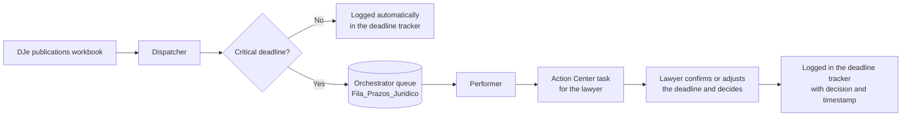

# Legal Deadline Monitor with Human-in-the-Loop (UiPath)

A UiPath automation that reads court publications from Brazil's electronic Official Gazette (DJe), **resolves routine deadlines on its own and sends only the critical ones to a lawyer for confirmation** in UiPath Action Center before recording them in the deadline tracker.

The robot handles the repetitive work. Decisions that carry legal risk stay with a person.

## The problem

Law firms and legal departments receive dozens of court publications every day. Each one must be read, its deadline calculated and the result logged in a tracking spreadsheet. Doing this by hand takes hours, and one missed deadline can cost a case. Fully automating it is risky too, because some deadlines (judgments, appeals, doubled deadlines) need a lawyer's interpretation.

## The solution

A **Dispatcher / Performer** architecture with an Orchestrator queue and a human approval step:

**Dispatcher** (`/Dispatcher`)
1. Reads the publications from the `Publicacoes_DJe` sheet.
2. For each publication:
   - **non-critical**: logs it directly in the tracker with source "Automático (robô)";
   - **critical**: adds an item to the `Fila_Prazos_Juridico` queue with the case number, the publication excerpt and the calculated deadline.
3. Appends the automatic entries to the `Prazos` sheet of `Controle_Prazos.xlsx`.

**Performer** (`/Performer`)
1. Gets the next queue item (`Get Transaction Item`).
2. Creates an **Action Center Form Task** with the case number, the publication excerpt and the suggested deadline.
3. **Suspends** the workflow (`Wait for Form Task and Resume`) until the lawyer responds: they confirm the deadline in days and choose a decision (*confirm*, *adjust* or *no deadline*).
4. Logs the answer in the tracker with source "Advogado (Action Center)", date and time.
5. Marks the transaction as successful (`Set Transaction Status`).

## Tech stack

UiPath Studio 25.10 · Orchestrator Queues · Action Center (Form Tasks, Persistence) · Excel Activities · VB.NET expressions · Dispatcher/Performer pattern · long-running workflows

## How to run

1. Open each project (`Dispatcher` and `Performer`) in UiPath Studio.
2. In Orchestrator, create the **`Fila_Prazos_Juridico`** queue and make sure Action Center is enabled on your tenant.
3. Sample data lives in `/Data` and is **entirely fictitious**, including the case numbers:
   - `publicacoes_dje_exemplo.xlsx`: Dispatcher input;
   - `Controle_Prazos.xlsx`: output (`Prazos` sheet).
4. Run the **Dispatcher**. Non-critical deadlines go to the tracker and critical ones go to the queue.
5. Run the **Performer** (from Studio, or from Orchestrator with an unattended robot). Tasks appear in Action Center. Once the lawyer submits the form, the robot resumes and records the decision.

> Sheet names, column names, the queue name and the form labels are in Portuguese on purpose: the automation is built for Brazilian courts and legal teams.

## Demo

**1. Dispatcher and Performer processes published in Orchestrator**

**2. `Fila_Prazos_Juridico` queue: critical publications waiting for the Performer**

**3. Action Center task: the lawyer confirms the deadline and records a decision**

**4. Result in the deadline tracker: entries logged automatically by the robot and confirmed by the lawyer**

## Next steps

- Pull publications straight from the DJe or a push service instead of a workbook.
- Use an LLM to classify the type of court act and suggest the deadline, with the lawyer keeping the final decision.
- Count deadlines in business days, including court holidays.
- Send email alerts for deadlines that are about to expire.

---

**Author:** Caio Bandeira · [LinkedIn](https://linkedin.com/in/caio-bandeira-cv) · [GitHub](https://github.com/CaioBandeira7)
