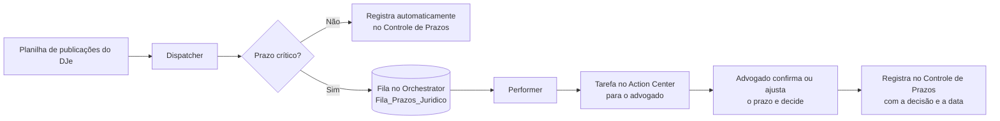
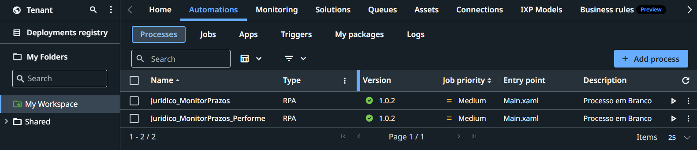
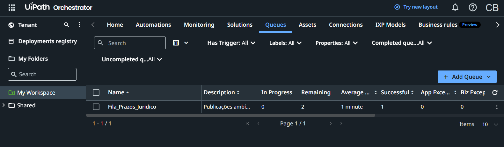
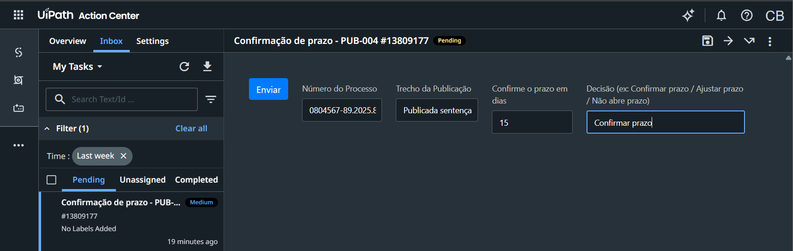
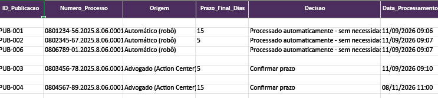

# Monitor de Prazos Jurídicos com Human-in-the-Loop (UiPath)

> 🇧🇷 Português · [🇺🇸 English below](#english)

Automação em UiPath que lê publicações do Diário de Justiça Eletrônico (DJe), resolve sozinha os prazos de rotina e **envia apenas os prazos críticos para um advogado confirmar** no UiPath Action Center antes de registrar no controle de prazos.

A ideia é simples: o robô faz o trabalho repetitivo, e a decisão jurídica que tem risco fica com uma pessoa.

## O problema

Escritórios e departamentos jurídicos recebem dezenas de publicações por dia. Cada uma precisa ser lida, ter o prazo calculado e ser lançada numa planilha de controle. Fazer isso à mão toma horas e um erro de prazo pode custar um processo. Automatizar tudo também é arriscado: alguns prazos (sentenças, recursos, prazos em dobro) exigem a interpretação de um advogado.

## A solução

Arquitetura **Dispatcher / Performer** com uma fila no Orchestrator e uma etapa de aprovação humana:

**Dispatcher** (`/Dispatcher`)
1. Lê as publicações da aba `Publicacoes_DJe`.
2. Para cada publicação:
   - **não crítica** → registra direto no controle como "Automático (robô)";
   - **crítica** → cria um item na fila `Fila_Prazos_Juridico` com número do processo, trecho da publicação e prazo calculado.
3. Grava os registros automáticos na aba `Prazos` do `Controle_Prazos.xlsx`.

**Performer** (`/Performer`)
1. Pega o próximo item da fila (`Get Transaction Item`).
2. Cria uma **Form Task no Action Center** com o número do processo, o trecho da publicação e o prazo sugerido.
3. O robô **pausa** (`Wait for Form Task and Resume`) até o advogado responder. Ele confirma o prazo em dias e escolhe a decisão: *Confirmar prazo*, *Ajustar prazo* ou *Não abre prazo*.
4. Registra a resposta no controle com origem "Advogado (Action Center)", data e hora.
5. Marca a transação como concluída (`Set Transaction Status`).

## Tecnologias

UiPath Studio 25.10 · Orchestrator (Queues) · Action Center (Form Tasks, Persistence) · Excel Activities · VB.NET expressions · padrão Dispatcher/Performer · long-running workflow

## Como rodar

1. Abra cada projeto (`Dispatcher` e `Performer`) no UiPath Studio.
2. No Orchestrator, crie a fila **`Fila_Prazos_Juridico`** e habilite o Action Center no seu tenant.
3. Os dados de exemplo estão em `/Data`. São **fictícios**, inclusive os números de processo:
   - `publicacoes_dje_exemplo.xlsx`: entrada do Dispatcher;
   - `Controle_Prazos.xlsx`: saída (aba `Prazos`).
4. Rode o **Dispatcher**: os prazos não críticos vão para o controle e os críticos vão para a fila.
5. Publique e rode o **Performer** pelo Orchestrator. As tarefas aparecem no Action Center. Ao responder, o robô retoma e grava a decisão.

## Demonstração

**1. Processos Dispatcher e Performer publicados no Orchestrator**

**2. Fila `Fila_Prazos_Juridico`: as publicações críticas aguardando o Performer**

**3. Tarefa no Action Center: o advogado confirma o prazo e registra a decisão**

**4. Resultado no Controle de Prazos: registros automáticos do robô e confirmados pelo advogado**

## Próximos passos

- Ler as publicações direto do DJe ou de um serviço de push em vez da planilha.
- Usar um LLM para classificar o tipo de ato e sugerir o prazo, com o advogado mantendo a decisão final.
- Contar prazos em dias úteis com feriados forenses.
- Notificar por e-mail os prazos próximos do vencimento.

---

# Legal Deadline Monitor with Human-in-the-Loop (UiPath)

A UiPath automation that reads court publications from Brazil's electronic Official Gazette (DJe), **resolves routine deadlines on its own and sends only the critical ones to a lawyer for confirmation** in UiPath Action Center before recording them.

**Architecture:** Dispatcher/Performer with an Orchestrator queue.
- **Dispatcher** reads the publications. Non-critical deadlines are written straight to the deadline tracker. Critical ones are pushed to the `Fila_Prazos_Juridico` queue.
- **Performer** takes each queue item and creates an Action Center Form Task. The long-running workflow pauses until the lawyer confirms or adjusts the deadline and records a decision. It then logs the result with source, date and time, and closes the transaction.

**Why it matters:** the robot handles the repetitive reading and data entry, while legally risky decisions stay with a person. This makes automation safe for a domain where one missed deadline can lose a case.

**Stack:** UiPath Studio 25.10, Orchestrator Queues, Action Center (Form Tasks / Persistence), Excel Activities, VB.NET expressions.

All sample data in `/Data` is fictitious.

---

**Autor / Author:** Caio Bandeira · [LinkedIn](https://linkedin.com/in/caio-bandeira-cv) · [GitHub](https://github.com/CaioBandeira7)
